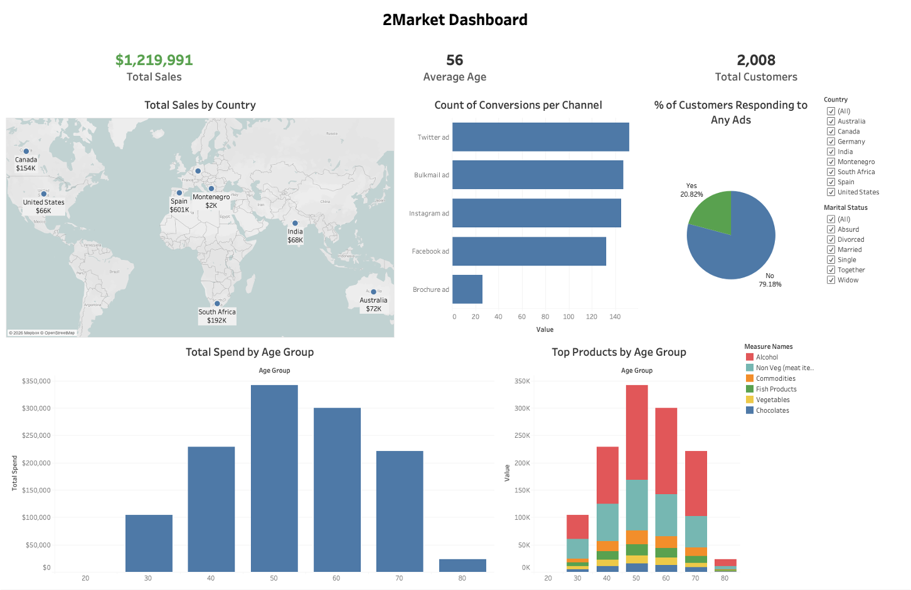
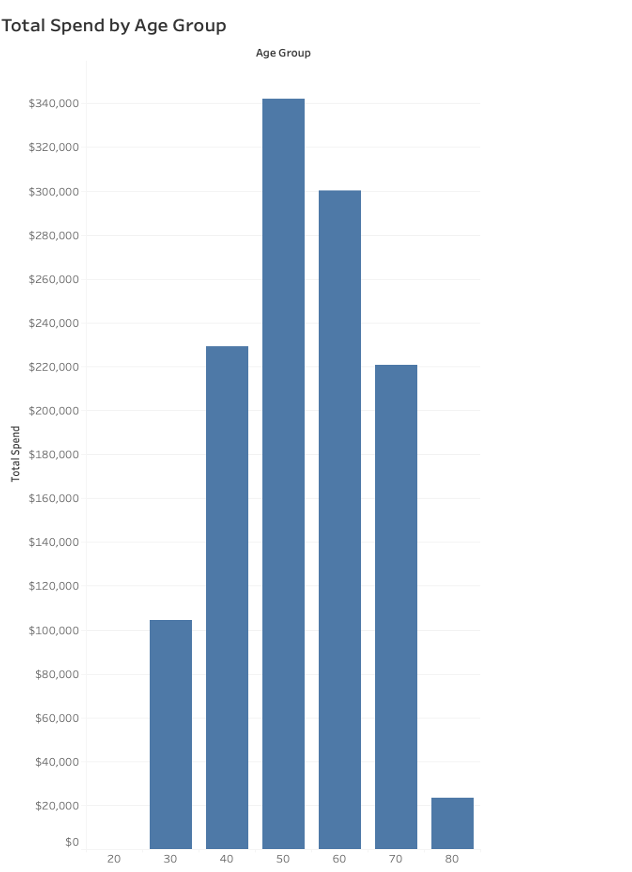
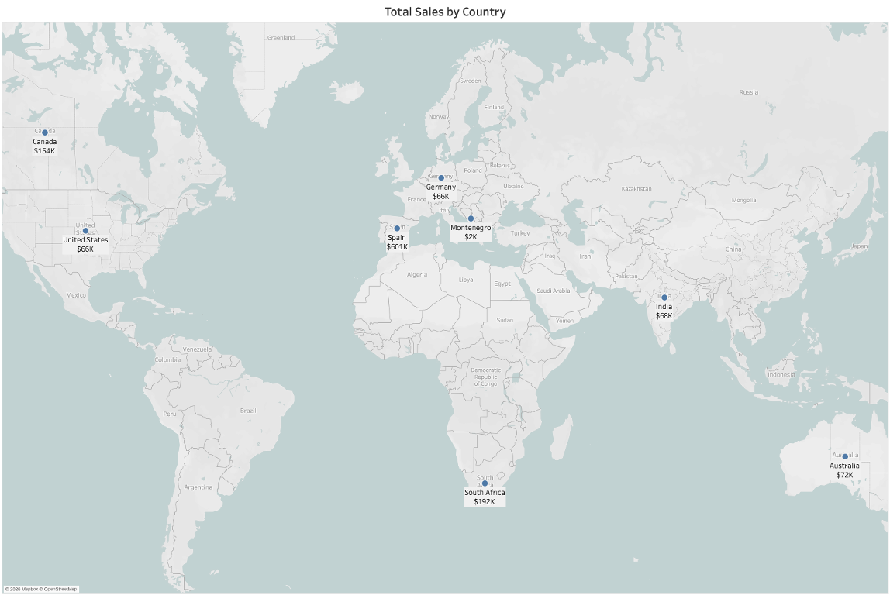
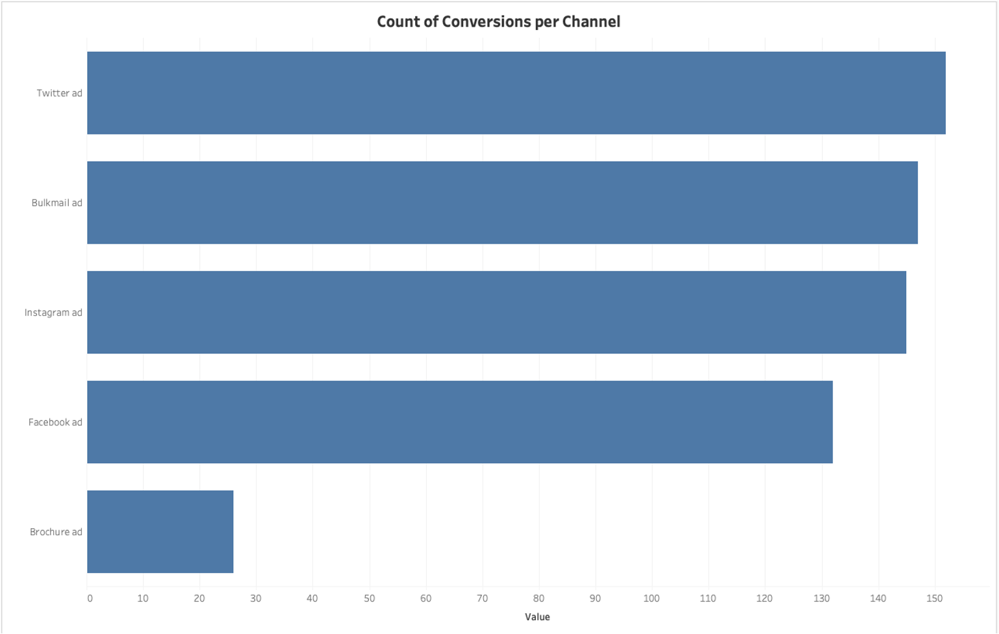
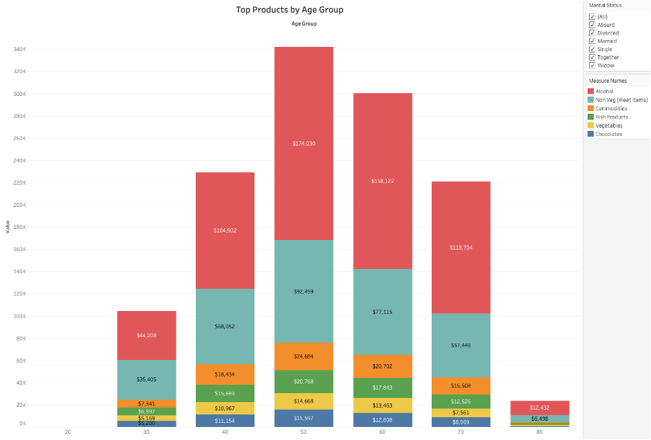

# 2Market: Customer Purchase Behaviour Analysis

### Project Brief

I carried out an analysis of customers, sales, and advertising data for 2Market, a global supermarket operating online and in-store, to identify who its customers are, which advertising channels convert them, and which products drive revenue across different demographics.

### Project Objectives

The analysis was done to answer 3 business questions:

- Who are 2Market's customers?
- Which advertising channels are the most effective?
- Which products sell best, and does this vary by demographic?

### Conclusion

2Market's revenue is highly concentrated: one country, one age band, and two product categories generate the majority of sales. Spain alone accounts for 49% of total revenue, customers aged 50–69 generate over half of all spend, and Alcohol and Non-Vegetarian products make up roughly 78% of spend. Digital advertising channels outperform Brochure advertising by more than 5x, yet only 20.82% of customers converted through any tracked channel.

**Recommendations:**

- Reallocate Brochure advertising budget to the higher-converting digital channels
- Prioritise stock, promotion, and placement of Alcohol and Non-Vegetarian products in Spain, South Africa, and Canada

---

### Project Outline

| 🛠️ Tools | 📂 Deliverables |
|---|---|
|   | Excel analysis workbook · Interactive Tableau dashboard · Technical report · Stakeholder presentation |

*The final dashboard: KPI strip, sales by country, advertising performance, and spend by age group, with Country and Marital Status filters applied across every view*

**[▶ View the interactive dashboard on Tableau Public](https://public.tableau.com/views/2MarketCustomerPurchaseBehaviourDashboard/2MarketDashboard?:language=en-GB&:sid=&:redirect=auth&:display_count=n&:origin=viz_share_link)**

---

### Analytical Approach

#### 1. Problem Definition

| Step | What Was Done |
|---|---|
| **Framework** | Applied the 5 Whys framework to trace the business problem to its root cause: the absence of structured analysis of existing data, rather than a lack of data |
| **Problem Statement** | 2Market could not identify its customer segments, measure advertising effectiveness, or see whether product preferences vary by demographic, limiting evidence-based decisions on marketing spend and product positioning |

#### 2. Data Cleaning (Excel)

| Step | What Was Done |
|---|---|
| **Data Integrity Check** | Ran a null value check across all fields to locate empty cells; no missing values were found, so no imputation was required |
| **Duplicate Removal** | The ID column contained no repeated values, but conditional formatting on the Income column exposed **205 records** where different IDs were assigned to identical customer data across every other column. These were removed as data entry errors to prevent inflated customer counts and skewed averages |
| **Data Type Conversion** | Income was stored as text with currency symbols and commas (e.g. "$62,499.00"). Symbols were stripped with Find and Replace and the column converted to a numeric format to enable aggregation |
| **Categorical Standardisation** | Recoded "Alone" to "Single" in Marital_Status, as both labels describe the same group and would otherwise create a false split in grouped analysis |
| **Feature Engineering** | Derived customer age from Year_Birth using `=YEAR(TODAY())-Year_Birth`, as no age field existed |
| **Outlier Treatment** | Removed **3 records** with calculated ages above 120 years as implausible entries that would have inflated the average age |
| **Data Quality Flags** | Retained the invalid "Absurd" marital status entry but flagged it for stakeholder clarification rather than reassigning it without evidence |

#### 3. Exploratory Analysis (Excel)

| Step | What was Done |
|---|---|
| **Conditional Aggregation** | Calculated average age by marital status with AVERAGEIF, and average age within the $90k–$100k income range with AVERAGEIFS |
| **Cross-Validation** | Rebuilt the marital status results in a PivotTable to confirm both methods produced matching figures |
| **Income Banding** | Grouped customers into six income bands using a nested IF helper column, as raw income values were too granular to reveal a trend |
| **Visual Exploration** | Plotted average age by income band as a line chart to show trend direction, and a scatter plot of age against income for the $90k–$100k segment to test for correlation |

#### 4. Tableau Dashboard

| Component | Details |
|---|---|
| **Calculated Fields** | Built fields for customer Age, Total Spend (sum of six product categories), and a Responded to Any Ad flag combining all five channels |
| **Geographic Mapping** | Wrote a CASE statement to convert the dataset's non-standard country codes (e.g. SP, GER, ME) into full country names, as Tableau could not geocode several of the original codes |
| **Data Structuring** | Used Measure Names and Measure Values to compare the six spend categories and five ad channels on shared axes without restructuring the data source |
| **Segmentation** | Grouped age into 10-year bins to make spend patterns comparable across age groups |
| **Interactivity** | Added Country and Marital Status filters that update every chart on the dashboard at once |
| **Design** | Top-to-bottom layout led by headline KPIs; a single blue palette across bar charts to avoid implying false categories; green reserved for the Total Sales KPI; distinct colours only where categories must be told apart |

---

### Major Insights

| Metric | Value |
|---|---|
| Total Sales | $1,219,991 |
| Total Customers | 2,008 |
| Average Customer Age | 56 |
| Customers Converted by Any Ad | 20.82% |

#### Customer Demographics

- The average customer is **56 years old**, placing 2Market's base firmly in the middle-aged to older bracket
- The **50–59 age group** generates the highest spend at around $342k, followed by 60–69 age group (~$301k). Together they account for over half of all revenue
- Spending drops sharply in the 30–39 group (~$105k), signalling weak engagement with younger customers
- Average age rises with income up to the **$50k–$70k band (average age 60)**, then falls in higher bands, so older customers are concentrated in mid-range incomes rather than the highest earners

*Total spend by 10-year age group*

#### Geographic Performance

> **Spain generates $601k, 49% of total revenue**, more than South Africa ($192k) and Canada ($154k) combined. This dependency on a single market is both 2Market's greatest strength and its largest concentration risk.

- The remaining five markets (Australia, India, Germany, United States, Montenegro) contribute just over $270k combined

*Total sales by country*

#### Advertising Effectiveness

- **Twitter (~152 conversions)** and **Bulkmail (~147)** are the highest-converting channels, closely followed by Instagram (~145) and Facebook (~132)
- **Brochure advertising converted only ~26 customers**, more than 5x fewer than any digital channel

> **Only 20.82% of customers converted through any advertising channel.** The remaining 79.18% purchased without a tracked advertising touchpoint, which points to a significant gap in advertising reach.

*Count of successful conversions per advertising channel*

#### Product Performance

- **Alcohol (~$612k, around 50% of spend)** and **Non-Vegetarian products (~$337k, around 28%)** dominate revenue
- This pattern holds in **every age group** and stays the same when filtered by marital status, so product preference does not vary meaningfully by demographic
- Fish, Commodities, Vegetables, and Chocolates each hold a small, stable share across all segments

  
   *Spend by product category within each age group*

---

### Business Recommendations

1. **Reallocate Brochure budget to digital channels.** Brochure converts at a fraction of the rate of Twitter, Bulkmail, Instagram, and Facebook. *Monitor:* track month-on-month conversions per channel after reallocation.
2. **Prioritise Alcohol and Non-Vegetarian products in Spain, South Africa, and Canada.** These two categories drive around 78% of spend, and these three markets generate over 75% of revenue. Concentrating stock depth, promotions, and placement here targets the highest-return combination. *Monitor:* track quarterly category revenue in these markets, using AmtLiq and AmtNonVeg as the baseline.

**Technical Recommendations**

- Clarify how offline Brochure conversions are recorded, as the lack of digital tracking may mean they are underreported
- Run Spain-specific analysis to determine whether its revenue is driven by customer volume or higher spend per customer
- Use the Recency field to segment customers by purchase activity and better understand the 79% not reached by advertising

---

### ⚠️ Limitations

- Brochure conversions lack digital tracking and may be underreported, which affects the channel comparison

---

### 📁 Repository Contents

| Folder | Contents |
|---|---|
| `excel-analysis/` | Workbook containing the original dataset, cleaned dataset, and analysis |
| `tableau/` | Packaged Tableau workbook (.twbx) |
| `images/` | Dashboard and chart screenshots |
| `reports/` | [Technical report](reports/technical_report.pdf) and [stakeholder presentation](reports/presentation.pdf) |

---

### 🔗 Interactive Dashboard

Explore the live dashboard here: [2Market Customer Purchase Behaviour Dashboard on Tableau Public](https://public.tableau.com/views/2MarketCustomerPurchaseBehaviourDashboard/2MarketDashboard?:language=en-GB&:sid=&:redirect=auth&:display_count=n&:origin=viz_share_link)

### 👤 Author

**Bosola Odunuga** · [LinkedIn](https://www.linkedin.com/in/bosola-odunuga-41507012a/)
